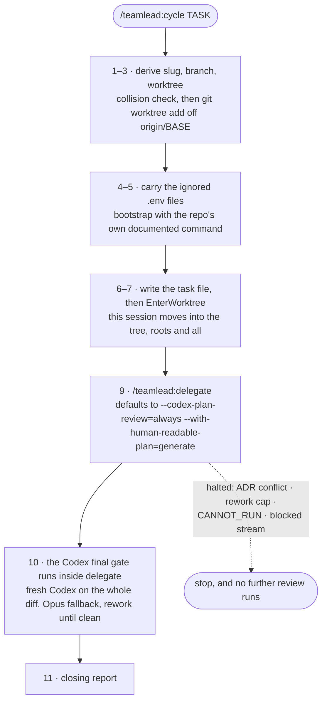

# teamlead

[](https://github.com/tp4k/claude-teamlead/actions/workflows/ci.yml)
[](LICENSE)

A [Claude Code](https://claude.com/claude-code) plugin for delegated work. One command plans a task, reviews the plan, dispatches specialist agents, verifies their changes (tests, a RED run, and a mutation gate), triages code, security, and performance reviews, and closes with an independent Codex review of the whole diff. The coordinator manages the process without writing implementation code.

Each role has a separate context, tools, and report. This lets the coordinator track parallel work while independent agents check the implementation.

## Install

```
/plugin marketplace add tp4k/claude-teamlead
/plugin install teamlead@claude-teamlead
```

## Quick start

```
/teamlead:delegate Add rate limiting to the public API, 100 req/min per key
```

Answer the options card and the one batch of planner questions. Type `go` to accept all recommendations. The run then proceeds to reviewed commits, subject to its hold conditions, and asks again only when it halts. It does not merge or push.

Want the fresh worktree too?

```
/teamlead:cycle Add rate limiting to the public API, 100 req/min per key
```

## How a run works

The diagram shows routing paths and conditions for optional steps. Step numbers match `skills/delegate/SKILL.md`.

```mermaid
flowchart TD
    GO(["/teamlead:delegate TASK"])
    CFG["3a · run_config.py<br/>resolves the 8 options → $RUN/config.json"]
    CARD{{"options card — plan review ·<br/>human plan · security · perf"}}

    subgraph PLANPHASE["Plan — no code exists yet"]
      direction TB
      PLANNER["4 · teamlead:planner<br/>plan.md · briefs/impl-ws*-r1.md · questions.md<br/>returns complex= and per-stream input: / hot: / public: tags"]
      VALID["4a · teamlead:plan-validator, pass 1<br/>falsifies the plan against the real tree"]
      CODEXPR["4a · Codex plan review<br/>background, 10–20 min"]
      OPUSPR["4a · teamlead:plan-reviewer"]
      HUMAN["4a · teamlead:writer<br/>plan-human.md"]
      LIVING["4a · teamlead:writer<br/>living ExecPlan sections"]
      PTRIAGE["5 · plan triage — coordinator<br/>plan-triage.md: CONFIRMED / WRONG / SETTLED / OPEN"]
      ASK{{"6 · ONE batch: open questions, design cards,<br/>the scope card · one AskUserQuestion card each, or 'go'"}}
      FIX["6b · teamlead:planner in Fix mode<br/>folds answers, CONFIRMED rows, the scope cut<br/>and the validator's findings into plan.md"]
      VALID2["6c · plan-validator, pass 2<br/>only when the Fix round added paths"]
      HOLD{{"6d · hold gate"}}
    end

    subgraph BUILDPHASE["Build — scripts/next.py routes every call; one pass per wave, repeated per rework round"]
      direction TB
      BASE["7 · baseline verifier per stream at the base SHA<br/>baseline-ws*.md"]
      IMPL["7 · teamlead:implementer, one per workstream<br/>parallel, each fenced to the scope block of its own brief"]
      VERIF["8a · teamlead:verifier<br/>brief commands · RED run · mutation gate<br/>PASS / FAIL / CANNOT_RUN, MUTATION: PASS / FAIL"]
      CODE["9 · code-review<br/>spec conformance, tests"]
      SEC["9 · security review"]
      PERF["9 · performance review"]
      TRIAGE["10 · triage — opus agent<br/>worst verdict wins, one row per defect"]
      DOCS["teamlead:writer · docs-fix: commit<br/>docs-only rows, no re-review"]
      GATE["10a · Codex final gate<br/>the whole diff, Opus fallback if Codex cannot run<br/>triaged into triage-gate-rK.md"]
    end

    HALT(["HALT — the plan contradicts an ADR"])
    YOU(["you confirm"])
    STOP(["STOP — the plan or the spec is wrong, not the coder"])
    REPORT["11 · ledger.py apply → docs/deferred-work.md<br/>then final-report.md"]
    ADRW["teamlead:writer · a new ADR"]
    LEDGER["teamlead:writer · $RUN/deferred-rows.md"]
    RERUN["runs /teamlead:codex-review on the fix commits<br/>were the findings fixed? · is the fix sound?<br/>Codex first · fallback kept if it was used"]

    GO --> CFG
    CFG --> CARD
    CFG -.->|"--use-config-options<br/>--autopilot"| PLANNER
    CARD --> PLANNER

    PLANNER --> VALID
    PLANNER -.->|"codexPlanReview = always,<br/>or hard + complex=yes"| CODEXPR
    PLANNER -.->|"opusPlanReview = always, or<br/>fallback + Codex unavailable"| OPUSPR
    PLANNER -.->|"humanReadablePlan ≠ off"| HUMAN
    PLANNER -.->|"complex = yes"| LIVING
    CODEXPR --> PTRIAGE
    OPUSPR --> PTRIAGE
    VALID --> ASK
    PTRIAGE --> ASK
    PTRIAGE -.->|"adr_conflict = yes"| HALT
    ASK -.->|"answers, CONFIRMED findings or validator findings change the plan"| FIX
    ASK -.->|"nothing to fold"| HOLD
    FIX -.->|"new_paths = yes"| VALID2
    FIX --> HOLD
    VALID2 --> HOLD

    HOLD -.->|"humanReadablePlan = pause ·<br/>CONFIRMED rows · complex with no design review"| YOU
    YOU --> BASE
    HOLD --> BASE
    BASE --> IMPL

    IMPL --> VERIF
    VERIF -.->|"FAIL on tests the change touched,<br/>or a surviving mutant → rework"| IMPL
    VERIF --> CODE
    VERIF -.->|"securityReview = on, or<br/>when-needed + input: yes"| SEC
    VERIF -.->|"perfReview = on, or<br/>when-needed + hot: yes"| PERF
    CODE --> TRIAGE
    SEC --> TRIAGE
    PERF --> TRIAGE
    TRIAGE -.->|"NEEDS_REWORK, under reworkCap"| IMPL
    TRIAGE -.->|"docs_only = yes"| DOCS
    TRIAGE -.->|"NEEDS_REWORK past reworkCap, or STOP"| STOP
    TRIAGE -->|"APPROVED, every stream"| GATE
    DOCS --> GATE
    GATE -.->|"NEEDS_REWORK, shares reworkCap"| IMPL
    GATE -.->|"rework past reworkCap"| STOP
    GATE -->|"clean, or codexCodeReview = off"| REPORT
    REPORT -.->|"adr = on"| ADRW
    REPORT -.->|"a row was demoted or a refactor deferred"| LEDGER
    REPORT -.->|"the task is a review-followup.md"| RERUN
```



Five workflow rules explain the diagram:

- **Review before implementation.** Design reviews and the plan validator inspect the draft together at step 4a. Their questions, design choices and any scope cut reach you in one batch at step 6. Step 6b folds the answers and every finding into one Fix round. A second validator pass (6c) runs only if that round added paths. Its review-tag upgrades govern step 9.
- **Verify before expensive reviews.** A sonnet agent reruns the brief's commands, then the RED run and the mutation gate (`mutate.py`: a broken line the tests do not notice is a survivor, and any survivor fails the gate). A failing suite or a surviving mutant therefore costs one small verification run instead of three opus reviews.
- **One router.** `scripts/next.py $RUN` does one call per phase: it waits for the last dispatch, reads the run directory and git, and prints the exact prompts to spawn. The coordinator composes no prompt, counts no round, and judges no cap. It starts with a baseline verifier per stream at the base SHA, so a command already failing there is pre-existing.
- **Gate the whole diff.** After triage approves every stream, Codex reviews the whole diff inside the run (the Opus `teamlead:code-reviewer` stands in when Codex cannot run). Triage folds its findings into rework rounds, and the gate loops until clean. Only rows you pick that are out of scope get a post-run follow-up.
- **Bound rework.** Verifier failures, surviving mutants, NEEDS_REWORK findings and gate findings return to a fresh implementer. All count toward `reworkCap`, default 3: it allows rework rounds 2–4, and a NEEDS_REWORK after round 4 halts for you. Persistent failure at the cap requires examining the plan or spec.

Triage verdicts are APPROVED, APPROVED_WITH_NOTES, NEEDS_REWORK, NEEDS_DECISION and STOP. A docs-only NEEDS_REWORK goes to a writer that commits `docs-fix:`, with no re-review. A NEEDS_DECISION takes its recommended choice, which is logged to `$RUN/decisions-log.md` and shown in the final report. Edits the coordinator makes at your request are committed as `coordinator-fix:`; `next.py` verifies them and the Codex gate sees them.

### `/teamlead:cycle` — the same run, plus the tree it runs in



`EnterWorktree` moves cwd and workspace roots together. Path-scoped CLAUDE.md loads only under those roots. Changing cwd alone can leave worktree subagents without its rules.

### How tests get written

One implementer writes tests and code. The test boundary preserves independent behavioral requirements:

1. **Plan behavior.** A `new:` line describes observable acceptance, such as the third request receiving 429. The implementer chooses assertions, fixtures, and mocks.
2. **Establish RED.** Each new test identifies a plausible wrong implementation and uses an input isolating its clause. It must fail behaviorally, not from broken imports or fixtures. Approximately 0–5 tests per stream is usual. Coverage percentage alone does not justify a test.
3. **Freeze.** Commit RED tests separately and run them once at that commit, while HEAD is RED, to copy each failure as evidence. Preserve every added line through implementation. `red_freeze.py` (without `--run`) checks retained lines. Later tests require a wrong implementation and an explanation of the coverage gap.
4. **Implement and probe.** After GREEN, temporarily break the specified behavior and confirm the test detects it. Add coverage for survivors without weakening frozen tests. The implementer also writes `probes-ws<N>-r<M>.json`, one concrete patch per `probe:` line of the brief.
5. **Check independently.** Only the verifier moves HEAD: after the brief's commands it reruns RED in place (`red_freeze.py --run`, while every writer is idle) and runs the mutation gate: the probe patches first, then up to 20 generic mutants of the stream's own changed lines. Lines no test can pin are never mutated: tests, prose, lockfiles, `package.json` dependency data (its `scripts` still are), and files `.gitattributes` marks `linguist-generated`; a stream that changed nothing else passes with a `NOTE:` saying the gate measured nothing. A survivor or an unapplied probe fails the gate and returns to the implementer. Reviewers read that report instead of building their own probe clones. Test-gap findings require a wrong implementation, a test it would pass, and the missing observable assertion.

The planner seeds a shared probe list from spec clauses. The implementer adds clauses introduced by its code. Review checks the list and reports surviving omissions as LIST_GAP.

For changes without reasonably testable behavior, report `tdd: NOT_APPLICABLE` with a precise reason. Examples include documentation, formatting, and pure renames.

## Where it stops for you

A cycle can present four routine decisions, subject to the selected settings. Mid-run questions are for halts only (STOP, CANNOT_RUN, the rework cap, a scope-fence block); any other call takes the recommendation and appears in the final report.

| # | Where | What you decide |
| --- | --- | --- |
| 1 | step 3a | The run options card. Current values are pre-marked — a chance to change your mind, not a form to fill in. |
| 2 | step 6 | One batch: the planner's open questions, a card for any design finding that is a real choice, and the validator's scope card when it names a cut. `go` accepts every recommendation at once. |
| 3 | step 6d | The hold gate: the plan is final and something wants your eyes on it. This is where `$RUN/plan-human.md` is worth reading. |
| 4 | `codex-review` step 4 | Which triaged out-of-scope findings to follow up. Optional: the in-loop gate already fixed the rest. |

Worktree collisions and ambiguous bootstrap setup can require additional decisions.

## Commands

In this workflow, planning defines the work. Design review assesses the approach. Validation checks plan facts against the repository. Verification executes commands and reports outcomes. Code and specialist reviews assess the implementation. Triage assigns findings their dispositions. User confirmation approves a plan or decision.

| Command | What it does |
| --- | --- |
| `/teamlead:delegate <task>` | Plans, reviews the plan, validates, implements, verifies (tests, RED run, mutation gate), reviews code and selected specialist axes, triages, then gates the whole diff with Codex. Uses the current tree. Presents required decisions and stops if rework reaches its cap. |
| `/teamlead:cycle <task>` | Creates and bootstraps a worktree from origin/main by default. Moves the session and runs delegate, whose final gate does the Codex review. |
| `/teamlead:codex-review [target]` | Gives [Codex](https://github.com/openai/codex) the task, plan, and diff for independent review. Records every finding once with its triage verdict and evidence. Delegate runs this review in-loop already; use the command for a run that skipped the gate, for pasted findings, and to follow up out-of-scope rows. |

Nothing in any of the three merges or pushes. There is no flag that makes them.

## Run options

Delegate resolves eight run options. They control design review, the human plan, specialist reviews, the in-loop Codex gate and its fallback, and ADR creation. The options card shows choices useful for the current run. `run_config.py` writes resolved values and their sources to `$RUN/config.json`. This record survives compaction and resume.

The **Turns on** column names the diagram node the option controls.

| Option | Flag | Values | Default | Turns on | Effect |
| --- | --- | --- | --- | --- | --- |
| `workflowProfile` | `--workflow-profile=<v>` | `standard` · `adaptive` | `standard` | Post-verification routing | `adaptive` pilots fewer stages for assessed small, low-risk tasks; preserves verification and independent cumulative final review. See [pilot protocol](references/adaptive-pilot.md). |
| `codexPlanReview` | `--codex-plan-review=<v>` | `off` · `hard` · `always` | `always` | 4a Codex plan review | An independent [Codex](https://github.com/openai/codex) review of the plan, before any code exists. `hard` runs it only when the planner called the task complex. |
| `opusPlanReview` | `--opus-plan-review=<v>` | `off` · `fallback` · `always` | `off` | 4a plan-reviewer | The same review by the in-session `teamlead:plan-reviewer`. `fallback` runs it only when Codex could not. |
| `humanReadablePlan` | `--with-human-readable-plan=<v>` | `off` · `generate` · `pause` | `off` | 4a writer, and the 6d gate | Writes `$RUN/plan-human.md` — the plan as prose, for reading rather than for dispatch. `pause` also holds the run until you read it and answer. |
| `securityReview` | `--security-review=<v>`, `--no-security-review` | `off` · `when-needed` · `on` | `when-needed` | 9 security review | The security reviewer at the end. `when-needed` spawns it only for workstreams the planner tagged as attacker-reachable. |
| `perfReview` | `--perf-review=<v>`, `--no-perf-review` | `off` · `when-needed` · `on` | `when-needed` | 9 performance review | The performance reviewer. `when-needed` spawns it only for workstreams the planner tagged as on a hot path. |
| `codexCodeReview` | `--codex-code-review=<v>` | `off` · `on` | `on` | 10a Codex final gate | After triage approves every stream, Codex reviews the whole diff inside the run. Its findings are triaged into rework rounds that share `reworkCap`, and the gate loops until clean. `off` skips the gate. |
| `opusCodeReview` | `/teamlead:codex-review --opus-code-review=<v>` | `off` · `fallback` | `fallback` | 10a gate fallback, codex-review 2b | When the Codex code review cannot run (no install, no login, a failure, a timeout), `teamlead:code-reviewer` reviews the same package instead. `off` halts the gate. The ledger says which reviewer wrote it. |
| `adr` | `--adr` | `off` · `on` | `off` | 11 ADR writer | Whether the run records its decisions as an ADR. Reading ADRs is always on and needs no setting. |

Per-stream code review is mandatory and has no disabling setting. The Codex final gate is on by default; `off` skips it.

`--use-config-options` skips the options card. `--autopilot` skips that card and other skippable stops. An explicit `--with-human-readable-plan=pause` still stops for the requested review.

The defaults apply with no config and no flag. Existing `$TEAMLEAD_HOME/config.json` files are not migrated: a key you already set wins over the new default.

Precedence is **card answer → flag → repository `.teamlead.json` → `$TEAMLEAD_HOME/config.json` → default**. The card is the user's latest answer and therefore overrides an earlier flag.

An invalid config value defers to the next tier. An invalid flag stops the run and lists valid values. This avoids breaking unrelated runs because of old config errors while preserving a newly entered command's intent.

`when-needed` uses each workstream's review tag. With `scopeFence: false`, both specialist settings become `on`. Unbounded file scope cannot reliably identify which stream needs a specialist.

## What gets installed

Eight agents. Each pins its own model and tool set, so the coordinator passes none:

| Agent | Model | Writes |
| --- | --- | --- |
| `teamlead:planner` | opus | `plan.md`, the round-1 briefs, `questions.md` |
| `teamlead:plan-reviewer` | opus | `plan-design-review.md` |
| `teamlead:plan-validator` | sonnet | `plan-validation.md` |
| `teamlead:implementer` | sonnet | the code, its commits, its own report |
| `teamlead:verifier` | sonnet | `verifier-rN.md`, `baseline-wsN.md`; the RED run and mutation report (`mutation-wsN-rM.md`) |
| `teamlead:triage` | opus | `triage-rN.md`, `triage-gate-rK.md`, and the next rework or docs-fix brief on NEEDS_REWORK |
| `teamlead:writer` | sonnet | `plan-human.md`, the living plan sections, an ADR, `$RUN/deferred-rows.md`, `docs-fix:` commits |
| `teamlead:code-reviewer` | opus | `opus-review-rN.md` — only when the Codex gate or `/teamlead:codex-review` falls back because Codex could not run |

The reviewers at step 9 are harness agent types (`code-review`,
`performance-engineer`, `security-review`), chosen per run.

The plugin installs five hooks without manual settings edits:

- **`PreToolUse` (allow)** pre-approves the report writes every teamlead agent
  makes inside its own state directory. It only ever grants: a write anywhere
  else gets no decision and follows the normal permission flow.
- **`PreToolUse` (deny)** refuses implementer edits outside the brief's active scope fence. It makes no decision for other writes. Set scopeFence to false to disable this check.
- **`PreToolUse` (step gate)** refuses planner, validator, or implementer dispatch when required earlier steps remain incomplete. Checks include config, promised review attempts, human plan, answers, Fix rounds, validation, and scope choices. Its step order matches run_state.py. It applies only to those roles in a real run. A failed Codex attempt does not block. Autopilot skips only configured skippable decisions.

- **`PreToolUse` (worktree)** pre-approves `/teamlead:cycle`'s one
  `EnterWorktree` switch, into the linked worktree its handover file in
  `$TEAMLEAD_HOME/tasks/` names, and only for the session that wrote it. Any
  other switch, or any other session, gets no decision.
- **`UserPromptSubmit`** names the session after the run. It never overwrites a
  title you chose yourself.

The plugin installs all five hooks user-wide. They make no decision outside teamlead runs.

## Safety rails

- **Nothing merges or pushes**, in any command, under any flag.
- **The coordinator edits the repo only on your request.** Its own writes are inside `$RUN`; a requested edit is a `coordinator-fix:` commit that `next.py` verifies.
- **Scope limits apply to implementers.** The hook refuses edits outside the brief. The coordinator checks scope again at triage.
- **The implementer role forbids these git operations:** `reset --hard`,
  `rebase`, `commit --amend`, `push --force`, `stash drop`, `checkout -- <path>`,
  and deleting commits.
- **The author is never the witness.** A verifier that did not write the code
  reruns the tests. Reviews follow PASS or the documented exception for untouched pre-existing failures.
- **RED tests stay fixed during implementation.** The reviewer checks the added lines with `scripts/red_freeze.py`; the verifier reruns RED in place. A findings row can explicitly authorize correction of an incorrect frozen test.
- **The plan never becomes a repo file.** A run leaves no untracked plan behind.
  the generated workflow records in the repo are ADRs and `docs/deferred-work.md`, which `ledger.py` fills once at close and never stages. Implementers create the files required by their tasks.

## The run directory

Run artifacts, worktree handover files, and config live under `$TEAMLEAD_HOME`, default `~/.teamlead/`. Plugin updates replace the plugin directory, so state lives separately. Set TEAMLEAD_HOME to move the state root.

```
~/.teamlead/
├── config.json                     your settings
├── tasks/<slug>.md                 /teamlead:cycle handover file
└── runs/<worktree>/<ts>-<slug>/    one run — this is $RUN
    ├── task.md                     the task VERBATIM, flags stripped
    ├── config.json                 the 8 resolved options + which tier set each
    ├── plan.md                     the spec every later reader grades against
    ├── plan-human.md               the same plan in about a page   (humanReadablePlan)
    ├── questions.md                the planner's questions + your ## Answers
    ├── briefs/impl-wsN-rM.md       what each implementer is told to build
    ├── briefs/review-rM-<axis>.md  each reviewer's brief, written by review_briefs.py
    ├── settled-wsN-rM.md           settled decisions copied into every reviewer brief
    ├── plan-review-package/        what Codex was given                (codexPlanReview)
    ├── plan-design-review.md       the in-session design review
    ├── plan-review-package/plan-review-r1.md   the Codex design review
    ├── plan-triage.md              your verdict on each of its rows, with evidence
    ├── plan-validation.md          PLAN_VALID / PLAN_NEEDS_FIX
    ├── base-sha.txt, next-state.json   what next.py pinned and last printed
    ├── baseline-wsN.md             the verifier at the base SHA: what already fails
    ├── implementer-wsN-rM.md       each coder's own report
    ├── probes-wsN-rM.json          the implementer's patch per brief probe: line
    ├── verifier-rM.md              the gate's exit codes, RED run and output tails
    ├── mutation-wsN-rM.md          the mutation gate's report
    ├── review-rM-{code,security,perf}.md
    ├── triage-rM.md                merged rows, one per defect
    ├── codex-gate-package/         what the Codex final gate was given   (codexCodeReview)
    ├── triage-gate-rK.md           the gate review, triaged
    ├── decisions-log.md            recommendations taken mid-run
    ├── deferred-rows.md            rows for docs/deferred-work.md, inserted at close
    └── final-report.md             what you get at the end
```

Read plan-human.md for planned behavior. Read config.json for resolved run options.

## Requirements

- **Claude Code**, recent enough to support plugins.
- **git**. `/teamlead:cycle` also needs `git worktree`.
- **Python 3.9+** for the bundled scripts. Standard library only — nothing to
  install, no virtualenv.
- **[Codex CLI](https://github.com/openai/codex)** with a saved login
  (`codex login`), for the final gate, `/teamlead:codex-review` and the plan design review.
  All are optional — `delegate` runs the whole loop without it, reports a plan
  review that cannot start and continues, and lets `teamlead:code-reviewer` stand in at the gate. Set `CODEX_BIN` if the
  binary is not on `PATH`.

## Configuration

Config files are optional. Copy [`config.example.json`](config.example.json) to `$TEAMLEAD_HOME/config.json` and retain the desired keys. The default path is `~/.teamlead/config.json`.

| Key | Default | Meaning |
| --- | --- | --- |
| `adrPath` | unset | ADR store root. Invalid or absent directories defer to the next config tier, then repository docs/adr. Skip ADR work if no store exists. |
| `adrSubdir` | `null` | Subdirectory within `adrPath`. |
| `reworkCap` | `3` | Rework rounds a workstream gets, gate rework included, before triage must stop. |
| `maxAgeDays` | `30` | A run directory older than this is prunable. |
| `keepLastPerRepo` | `5` | ...unless it is among the newest N runs of its repo. |
| `scopeFence` | `true` | Whether the scope-fence hook refuses out-of-scope implementer writes. |
| `planValidatorPasses` | `1` | Recorded in `config.json`; no longer changes routing. Pass 1 runs at 4a beside the design review, and pass 2 (6c) runs only when the Fix round returned `new_paths=yes`. |
| `codexPlanReviewAxes` | all five | Which of `decomposition`, `task-fit`, `acceptance`, `design-fit`, `failure-modes` the plan design review covers. |
| the eight [run options](#run-options) | per the table | Same keys, same values as the flags, defaults in the Default column — a config entry is how you stop typing one. |

Repository `.teamlead.json` overrides global config. Values of the wrong type defer to the next tier and then the default.

The defaults live in code (`scripts/paths.py`), not in a shipped file. The first run seeds user config with a comment and no keys. A config you already have is never migrated: its keys win over the in-code defaults, so an older `securityReview: on` stays on.

## Troubleshooting

| Symptom | Cause and fix |
| --- | --- |
| `Agent type 'planner' not found` | Use the namespaced agent type: `teamlead:planner`. The bare name is not registered. |
| The plan design review never appears | Codex has no saved login, or is not on `PATH`. The run reports it and continues by design — set `CODEX_BIN`, or run `codex login`. Set `opusPlanReview=fallback` so the review happens anyway. |
| The Codex final gate stops with a Codex login or timeout error | Same cause, at the end of the run. `opusCodeReview=fallback` (the default) lets an Opus review of the same package stand in; `off` halts the gate. `/teamlead:codex-review` follows the same rule, and its ledger identifies `reviewer: Opus fallback`. |
| A specialist review is missing from the report | `when-needed` with the planner's tag at `no` deletes that review rather than shrinking it. The final report names every specialist that did not run, and the tag that decided it. |
| Runs vanished from a bookmarked path | They live under `$TEAMLEAD_HOME`, and kickoff prunes old runs according to `maxAgeDays` / `keepLastPerRepo`. |
| Kickoff says `REFUSED: another copy of this plugin` | A second plugin copy under `~/.claude/skills/` can load the wrong skills. Move it out with `git worktree move`. Test branches with `claude --plugin-dir <path>` and start a new session. |
| No options card, no plan review, and old runs never had a `config.json` | The same shadowing, from before kickoff checked for it: the session ran an older copy's `delegate`. Fix as above. |
| The gate refuses a spawn with `Not yet: this run is at step …` | The step gate found an earlier step still owed. Complete the named step. `run_state.py $RUN` shows where the run stands. |
| `next.py` prints `halt:` | The loop stops here by design: STOP, CANNOT_RUN, a rework past `reworkCap`, a report with no status, or a commit the report lists that git lacks. Read the line, fix the cause, and call it again. |
| The scope hook refuses a required file | That is the scope fence asking you to widen it. Expand the next brief with the full active fence, or explicitly decline the associated finding. |

## Tests

The test suites use Python's standard library and require no pytest installation:

```sh
for suite in scripts/test_*.py; do python3 "$suite"; done
ruff check .
```

CI runs the same two things on Python 3.9 through 3.13.

## License

[MIT](LICENSE).

### Final gate verification

The final gate reviews the cumulative deliverable from the package's resolved
upstream target base. Its prompt records the run's pinned verification / rework
base separately; baseline verification and round accounting keep that base.
Standalone follow-up reviews still default to the earlier reviewed head.

Codex and the Opus fallback trace caller contracts and multi-step behavior, then
run independent targeted probes for unresolved concrete risks in disposable
trees. Reports require `Verification: COMPLETE` or `Verification: CANNOT_RUN`.
An essential unexecuted check blocks triage and closure, without consuming code
rework. After resolving its execution blocker, run:

```sh
python3 scripts/next.py "$RUN" --retry-gate
```

This starts a fresh gate and retains earlier artifacts. Unstarted rework briefs
from the superseded gate move under the run’s `archive/`; completed rounds stay
in place. Triage assigns cumulative
findings by responsibility and explicitly expands implementation scope when a
confirmed defect requires it. The final report records executed checks and limits.

### Generated-PR outcome pilot

The default workflow is unchanged (`workflowProfile: "standard"`). Opt in with `--workflow-profile=adaptive` or the matching config key. Only one bounded, small, low-risk workstream with a current validator assessment skips per-stream reviews and triage; baseline checks, verification, mutation checks, and independent cumulative final review remain. Rework, uncertainty, risk, missing evidence, or explicit specialist review requests retain the existing stages. See [the assessment, measurements, and ten-task pilot protocol](references/adaptive-pilot.md).

Generated current briefs preserve inherited constraints and explicit fix/decline/defer decisions across rounds. Baseline batches marked `verification resource: shared-database` and all post-change verification are serialized. Private run metrics record observed phase duration, available cached/uncached/output tokens, rework causes, and subsequently confirmed PR findings; missing measurements remain explicitly unavailable. Internal approvals and test counts are not quality measures.
